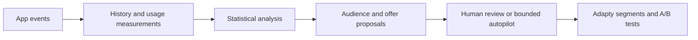

# Feature Signal for Adapty

## Quick start

You need **Docker Compose**, **Git**, **Make**, and **Node.js 20.19+ or 22.12+**.

From the downloaded repository:

```bash
cp .env.example .env
```

Fill in these values in `.env`:

- `ADAPTY_APP_ID` — the Adapty app to connect.
- `ADAPTY_SECRET_KEY` — its server-side API key.
- `OPENAI_API_KEY` — for AI rule suggestions and explanations.

Then log in to the Adapty CLI and start the demo:

```bash
docker compose run --rm --build adapty-login
make offline-data
make demo

cd web
npm ci
npm run dev
```

`make demo` starts the backend through Docker Compose, runs database migrations, and loads synthetic activity events. The frontend runs separately.

Open **http://localhost:5173** for the dashboard, **http://localhost:5173/demo** for the demo app, and **http://localhost:8000/docs** for the API.

The included configuration expects the Lumen demo’s flows, profiles, and placements in Adapty. Connecting another app requires updating those mappings; see [runtime configuration](docs/adapty/13-brain-wiring.md).

If the selected Adapty demo app does not contain the Lumen user profiles, create the missing identities before approving proposals:

```bash
docker compose exec api python scripts/seed_adapty_profiles.py --users 5000
```

This skips existing profiles and marks new ones as synthetic. It does not create purchases or subscriptions.
See [approval troubleshooting](docs/adapty/17-approval-repair.md).

To explore just the interface without credentials or a backend, run `VITE_USE_MOCKS=true npm run dev` from `web/`. This mode displays a labeled mock preview.

## Make paid offers relevant to how people use your app

Feature Signal helps app teams use product activity to decide which offers to test with different groups of users. It connects the features people use with Adapty’s audience targeting and A/B tests.

The goal is to increase the likelihood of a purchase by giving users a clearer reason to upgrade: an offer that relates to something they already find useful in the app.

Users can use the same app for very different reasons. In a photo editor, one person might regularly use AI enhancements, another might mainly remove backgrounds, and another might rarely get past importing a photo. Those differences give a team useful questions to investigate.

Would an offer focused on AI editing be more relevant to frequent AI users? Does repeatedly trying a paid export feature indicate interest in upgrading? Which of these observations is supported by purchase data?

Turning those questions into targeting usually means deciding what to track, writing rules to calculate it, creating audiences, and keeping their attributes updated. Feature Signal connects that work in one workflow, from activity events to a proposal the team can review and test through Adapty.

## From activity to an offer experiment

The dashboard follows the same sequence as the underlying system:

1. **Describe the features and events.**
   Register features such as AI editing or full-resolution export, the actions associated with them, and the plans that include them. The SDK sends events when those actions happen.

2. **Build useful measurements.**
   Basic values, such as total uses and usage over the past week, are created automatically. AI can suggest additional rules from the declared events and properties—for example, distinct photos processed, the proportion of blocked export attempts, or whether a quota was exhausted.

3. **Check the evidence.**
   The analysis looks for behavioral signals associated with revenue and checks whether they hold on users excluded from threshold selection. It then examines historical randomized offer comparisons for the resulting groups. A new rule without matching outcome data remains an unmeasured hypothesis.

4. **Review a proposal.**
   The proposal brings together the audience, proposed offer, supporting evidence, uncertainty, and test split. The operator can edit the allowed fields, reject it, or approve the experiment.

5. **Activate and keep membership current.**
   Approval writes the relevant attributes, creates or updates the Adapty segment, and starts an A/B test. As users generate more events, their measurements and group membership are recalculated. Only changed profile attributes are sent to Adapty.

The [dashboard walkthrough](docs/web/README.md) explains each screen. The [event-to-paywall diagram](docs/diagrams/flow.md) shows how the analysis and membership updates connect.

## How the system works



The JavaScript SDK attaches an event ID, customer ID, and occurrence time to each event. Events are buffered and retried with the same IDs, so a repeated delivery is counted once. The backend stores the history and computes values using the event’s occurrence time.

Rules are stored as definitions. Once the relevant events are instrumented, the team can add a measurement without changing the application’s tracking code. Supported measurements include counts, distinct values, ratios, active days, and numeric properties, with optional conditions and time windows.

The statistical analysis answers two separate questions:

- **Which behavior distinguishes groups of users?** Thresholds are selected on training data and checked on held-out users.
- **Which offer has evidence behind it for a group?** Offer comparisons use the dataset’s randomized A/B arms and a consistent revenue window, accounting for refunds.

AI helps propose measurements and supply constrained explanatory hypotheses. Numerical results, thresholds, and offer comparisons are calculated by code. Accepting a suggestion does not automatically make it a confirmed signal.

See the [SDK documentation](sdk/js/README.md), [ingest sequence](docs/diagrams/ingest-sequence.md), [ranking methodology](docs/brain/02-ranking-and-tiers.md), and [offer-comparison methodology](docs/brain/04-uplift.md).

## Integration with Adapty

Feature Signal and Adapty use the same `customer_user_id` to connect activity with a profile. Event history and calculated measurements stay in Feature Signal. Adapty receives the current targeting attributes:

| Attribute | Meaning |
|---|---|
| `p_segment` | The approved behavioral group the user currently belongs to. |
| `f_<feature>_tier` | A measured usage tier—low, mid, or high—for a feature. |

Adapty segments combine these attributes with native filters such as platform or subscription state. Users are evaluated individually, while offers are served to the resulting audiences.

The integration uses:

- **The server-side API** to update profile attributes. Membership synchronization sends only changes and removes attributes when they no longer apply.
- **The Adapty CLI** to inspect flows and placements, create or update segments, and create and start A/B tests. The placement’s existing default flow supplies the control offer.
- **A webhook receiver** to store purchase and refund notifications in the event pipeline. The current insight demo uses the supplied historical datasets for its outcome analysis.

Adapty remains responsible for paywall delivery and purchases. The dashboard’s lookup tool shows the audience and available A/B arms returned by Adapty; the SDK selects the arm on the device.

The backend can also create a draft copy of an existing flow with a revised title. Products and billing configuration are preserved, and any declared feature highlight is checked against the offered plans.

Implementation details are documented in [membership synchronization](docs/adapty/05-membership-sync.md), [activation](docs/adapty/06-activation.md), [paywall drafts](docs/adapty/09-paywall-draft.md), and [webhook handling](docs/ingest/09-adapty-webhook.md).

## Review and automation

Human review is the default. Proposal edits and decisions are recorded, and the decision log shows which activation steps succeeded or failed.

Autopilot can launch eligible experiments within configured limits on simultaneous proposals and minimum control allocation. The current demo configuration restricts automatic launches to the `fs_test` placement.

Publishing a new flow remains a human action in either mode. A proposal requiring publication waits until the flow is published and approval is resumed.

See the [proposal lifecycle diagram](docs/diagrams/proposal-lifecycle.md) and [autopilot behavior](docs/adapty/16-autopilot-launch.md).

## Technology

| Technology | Role |
|---|---|
| **TypeScript SDK** | Buffers events, attaches identifiers and timestamps, and retries delivery. |
| **Python and FastAPI** | Serve the API and coordinate ingestion, analysis, proposals, and integrations. |
| **Pydantic** | Validates API payloads and structured model responses. |
| **SQLite, SQLAlchemy, and Alembic** | Store events, measurements, proposals, and decisions; manage database access and migrations. |
| **pandas and NumPy** | Prepare datasets and calculate rankings, offer comparisons, and uncertainty intervals. |
| **OpenAI** | Suggests measurement rules and supplies constrained explanatory hypotheses. |
| **React, TypeScript, Vite, and TanStack Query** | Provide the dashboard, demo interface, and API-backed interactions. |
| **Docker Compose** | Runs the backend with its dependencies and Adapty CLI. |
| **pytest, Vitest, Testing Library, and MSW** | Check backend behavior, SDK delivery, frontend interactions, and API contracts. |

The backend separates API routes, services, pure analytical functions, repositories, and external adapters. This allows statistical logic to be tested independently and external services to be replaced with fakes in automated tests.

See the [system architecture](docs/diagrams/system.md), [data model](docs/diagrams/data-model.md), and [API contract](docs/contracts/api.md).

## Demo data and verification

The Lumen dataset and generated activity events are synthetic. They provide a reproducible demonstration of the workflow and analysis; they do not establish a revenue improvement for a real app. The current live-demo configuration uses a 60-day outcome window, documented in the [window decision](docs/brain/10-outcome-window.md).

Backend activation has been exercised against a real Adapty test placement. Browser checks cover both the labeled preview and local API interactions; the complete live browser sequence remains separately tracked. The webhook receiver is implemented and tested locally, with live delivery still requiring verification.

See the [Adapty run record](docs/adapty/14-real-run.md) and [browser verification notes](docs/web/07-live-verification.md).

## Running checks

From the repository root:

```bash
make test-docker
```

Frontend:

```bash
cd web
npm test -- --run
npm run build
```

SDK:

```bash
cd sdk/js
npm ci
npm test -- --run
npm run typecheck
```

## More documentation

- [All development documentation](docs/README.md)
- [Architecture and workflow diagrams](docs/diagrams/README.md)
- [Shared interfaces and ports](docs/contracts/ports.md)
- [How we developed with AI](AI_LOG.md)
