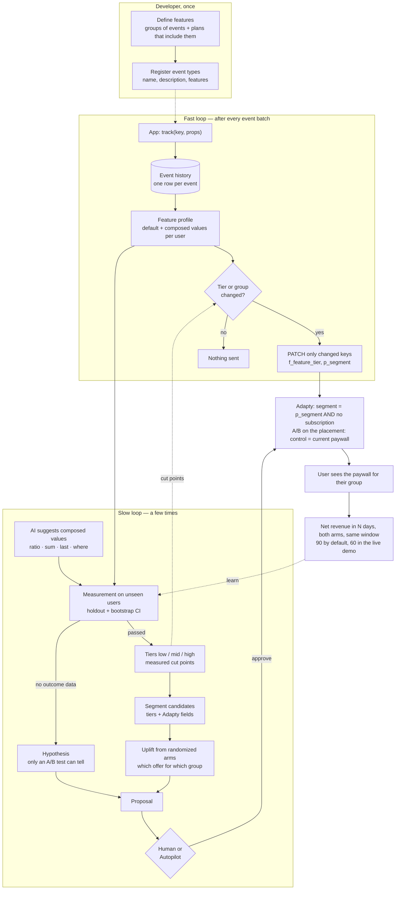

# From a click to a paywall

Two speeds. The **slow loop** decides what matters and which offer a group gets (a few times in total).
The **fast loop** keeps each user in the right group after every event (seconds).

What goes to Adapty: at most 10 `f_<feature>_tier` keys plus `p_segment` (11 of 30 attributes).
Everything else — history, profiles, raw values — stays with us.
