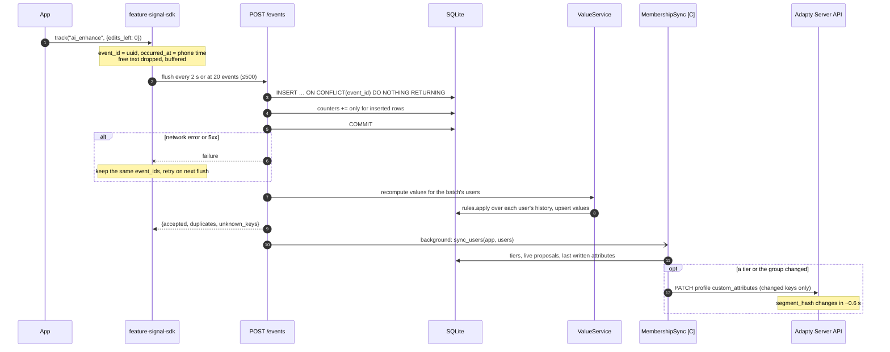

# Ingest sequence

What happens when the app sends events. Implemented in `sdk/js/src/index.ts`,
`repositories/events.py`, `services/ingest_service.py`, `services/value_service.py`; the membership
sync is C's (`app.state.membership_sync`).

