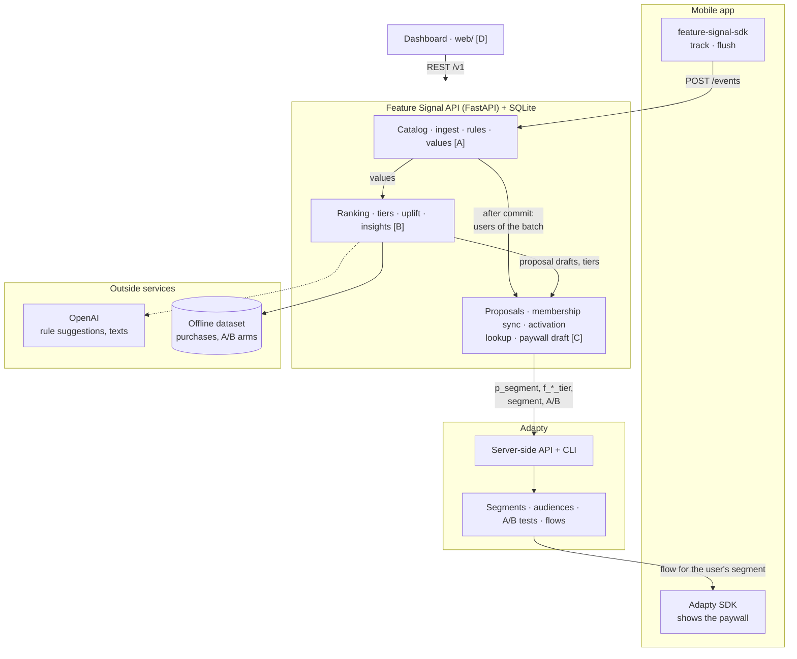
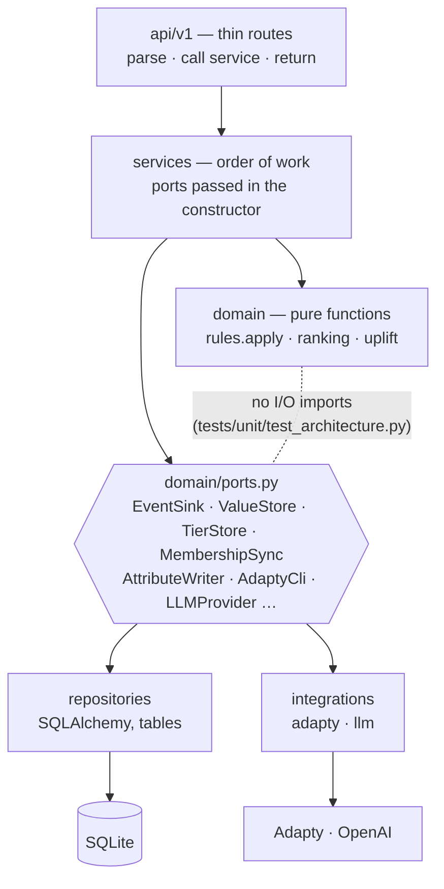

# System

Who talks to whom. Owners in brackets (A ingest & rules, B brain, C Adapty & proposals, D dashboard).
In the demo the mobile app is `web/demo`.

## Code layers

Every area follows the same layers. `domain/` is pure, so statistics can never call the LLM.

